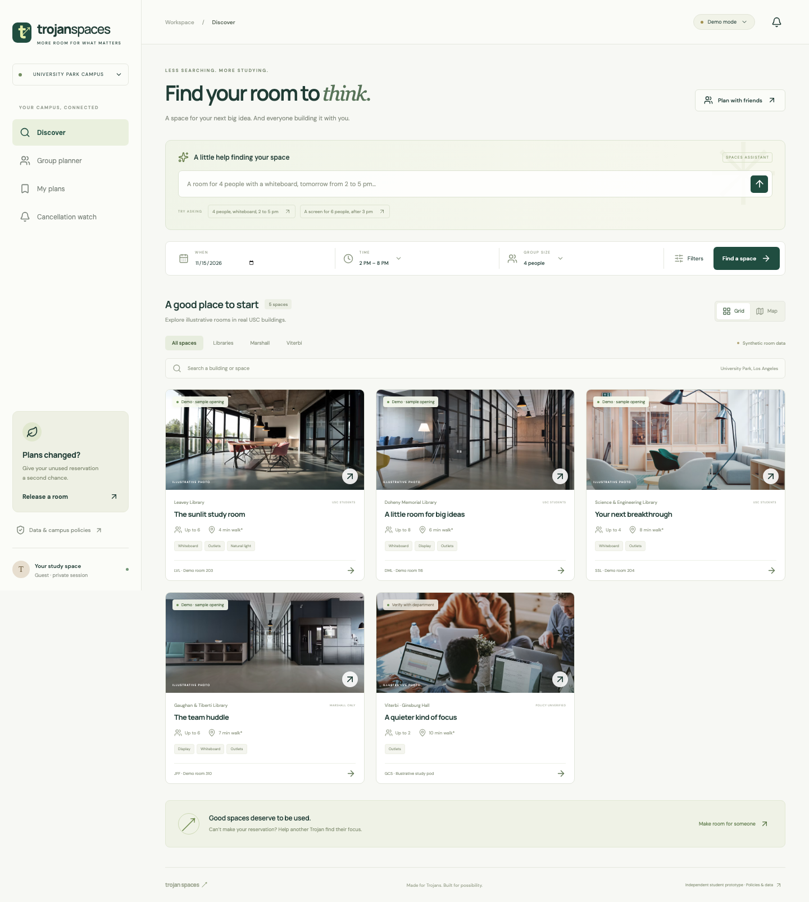

# Trojan Spaces ↗

**Make every room count.** A mobile-first USC study-space discovery and group-planning PWA, built for AI@USC, November 14–15, 2026.

> Working demo, honest boundaries: real USC building/system references; synthetic room IDs, photos, capacities, amenities, availability and walking times. No official reservation API is connected. Official directory mode never implies live availability. This is an independent student prototype.



## Run in two minutes

Requires Node.js 22.13+ (24 LTS recommended), npm, and native build tools if a SQLite binary is unavailable.

```sh
npm ci
cp .env.example .env.local
npm run build
npm start
```

Open http://localhost:3000. No accounts or API keys are needed for demo mode. Local data persists in `.data/spaces.sqlite`, excluded from Git. Development: `npm run dev`.

## What works

- Natural-language request interpretation. Without a key, a labeled local demo parser supports numeric group sizes, durations, hour ranges, and amenities. With `GEMINI_API_KEY`, validated Gemini JSON extraction handles richer language. Review fields before planning. Eligibility always stays user-selected.
- Deterministic constraint optimization over capacity, required amenities, complete group overlap, school eligibility, synthetic inventory and excluded rooms. Half-hour slots, 30–120-minute sessions. Each result includes a reason and an auditable state history.
- Shareable bearer-link groups with real persisted multi-user availability collection. Row locks / SQLite transactions prevent simultaneous joins losing members. Invite links preserve the study date. Changing the date starts a fresh crew.
- Stateful plan recovery: simulate an unavailable room, exclude it, and re-optimize while preserving constraints. A no-match result is an explicit state.
- Leaflet/OpenStreetMap campus map, building search, categories, room detail and eligibility guidance.
- Opt-in, persistent synthetic cancellation watches and in-app alerts. Delete watches any time. No background school polling, email or push infrastructure is enabled.
- Voluntary release state machine: official cancellation step, user attestation, separate simulated provider availability check. Never transfers a reservation or treats cancellation as proof of availability.
- Honest official booking handoff. Handoff records are never marked confirmed. No booking completion claim exists without an authorized confirmation adapter.
- Persistent SQLite locally or Postgres remotely, private random session cookies, same-origin request checks, schema validation and atomic group joins.
- Responsive mobile/desktop layout, install manifest, icons and service worker with an honest offline fallback. Availability is never served stale as live.

## AI setup

Set `GEMINI_API_KEY` on the server and optionally `GEMINI_MODEL` (default `gemini-2.5-flash`). Key stays server-side. Requests time out after 15 seconds; errors remain visible and manual filters remain usable. Only entered request text and selected date go to Google. Do not include personal data. Extraction uses JSON mode plus Zod validation. The optimizer, eligibility gates and state transitions remain deterministic. See [Google's generation API](https://ai.google.dev/api/generate-content) and [structured output guidance](https://ai.google.dev/gemini-api/docs/structured-output).

## Deployment

**Recommended:** a Node host with a persistent disk (Docker on Render, Railway, Fly, or a VM). Mount a persistent volume at `/app/.data` for SQLite. HTTPS is required for install/service-worker features and secure session cookies.

```sh
docker build -t trojan-spaces .
docker run --rm -p 3000:3000 -v trojan-data:/app/.data trojan-spaces
```

**Supabase / Postgres:** set server-only `DATABASE_URL` to the database's TLS connection string (Supabase pooler for your hosting topology). Apply `supabase/schema.sql` before running. Tables also initialize automatically for a role with DDL permissions. A restricted application role with table permissions is preferable after migration. No Supabase service-role key or browser database access is used.

**Vercel / ephemeral hosts:** configure Postgres; SQLite files will not be durable. The API requires Node runtime, not Edge. Import this repository, set `DATABASE_URL` and optional Gemini variables, use `npm run build`, then deploy. Do not expose the app publicly with SQLite on an ephemeral filesystem.

Before institutional deployment: obtain explicit provider API permission and credentials, verify room-level metadata, add USC SSO, durable rate limits and abuse controls, institutional retention rules, real event/webhook scheduling, monitored delivery and provider-side confirmation. Live features deliberately stay disconnected until those integrations exist. No scraping of authenticated pages or eligibility workaround is implemented.

## Verify

```sh
npm test
npm run typecheck
npm run build
npx playwright install chromium
npm run test:e2e
```

Unit tests cover group overlap, capacity, amenities, eligibility, conflict exclusion and input validation. Browser/API tests cover persistence, mobile overflow, maps, session isolation, group joins, consent, ordered release states and honest live mode. Screenshots are captured from the running app into `docs/screenshots/`.

## Architecture

`components/Spaces.tsx` owns the interface; `lib/planner.ts` validates and optimizes; `lib/ai.ts` extracts intent; `app/api/engine/route.ts` checks state transitions and session ownership; `lib/db.ts` persists records. Postgres and SQLite share the same storage contract. All observed room openings are demo fixtures. Official URLs are hardcoded from researched primary sources rather than supplied by AI.

Sessions expire after 30 days in the browser. This MVP has no user accounts or automatic server-side deletion schedule. Clearing the cookie creates a new private workspace but does not erase prior database rows. Group links reveal names/availability to anyone holding the link; avoid sensitive data. Database operators must implement retention/deletion procedures before institutional use.

## Submission package

- [Devpost copy and rubric mapping](docs/DEVPOST.md)
- [110-second video script](docs/DEMO-SCRIPT.md)
- [Research and event requirements](docs/RESEARCH.md)
- [Implementation status and limitations](docs/STATUS.md)
- [Screenshot gallery](docs/screenshots/)

Room photographs are illustrative, served by Unsplash. Map tiles are from OpenStreetMap with attribution. Project code is MIT licensed; third-party assets and dependencies retain their own terms. No USC marks or official endorsement claims are included.
